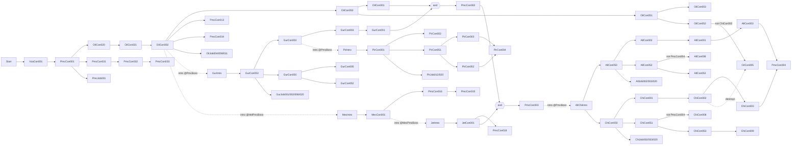

# Mission progression graph

How *Mercenaries 2* decides which mission comes next, read from the decompiled shipped Lua, plus
the traps and the ground-truth data available to anyone building a progression graph or a harness
that runs the mission scripts.

Line numbers below are **decompiled-corpus lines** (`docs/mercs2-luacd/src/…`, identical to the
copy vendored at `tools/wad_simulator/crates/mercs2_script/corpus/`). They are not the line numbers
the retail game reports — see [§5.1](#51-retail-line-numbers-are-not-corpus-line-numbers).

Peers: [`mission_inventory.md`](mission_inventory.md) (every mission, classified),
[`mission_construction_patterns.md`](mission_construction_patterns.md) (the recipes),
[`../vanilla_mission_lifecycle_analysis.md`](../vanilla_mission_lifecycle_analysis.md) §3 (the
same graph as a binding list), and the Missions-page extractor design
[`tools/wad_simulator/docs/scripts_graph_spec.md`](../../tools/wad_simulator/docs/scripts_graph_spec.md).

## 1. The mechanism

### 1.1 One table of rules

The whole campaign graph is `GetOriginalFlowData()` in
[`vz/wifmissionflow.lua:27-1407`](../mercs2-luacd/src/vz/wifmissionflow.lua#L27). It returns
**67 named rules**. Each has:

- `fPrereq` — a condition over progression keys: `HasKey(k)`, `not HasKey(k)`, or
  `GetKeyValue(k) >= n`. `Start` is `return true`. No rule reads anything but keys.
- `fConseq` — what happens when the condition first holds: `UnlockMission`, `DestroyMission`,
  `AwardKey`, faction intros, world-layer swaps, movies, hints, achievements, starter changes.

66 rules have both. `PmcJob001` (`:675-679`) has a condition and **no consequence**, so it never
fires (see 1.3). Four rules (`PmcCon031_x3` … `PmcCon034_x3`) use a named function as the
consequence (`fConseq = _AddHeroCostume`) rather than an inline closure.

`tMissionData` (`vz/wifmissiondata.lua`) holds mission attributes and **no edges**.

### 1.2 Where keys come from

| Source | Key | Code |
|---|---|---|
| Mission completes | the mission's own name | `_OnContainerComplete` → `AwardKey(sMissionName)`, [`resident/mrxmissionflow.lua:169`](../mercs2-luacd/src/resident/mrxmissionflow.lua#L169) |
| Mission completes | `tMilestones[i].sKey` — jobs: every milestone not yet held; contracts: the one whose `nMilestone` equals the completion count | `mrxmissionflow.lua:171-185` |
| Job target reached | `sMilestoneKey` / milestone key | `resident/mrxtaskjob.lua:147,157` |
| Faction intro watched at a starter NPC | `<IntroName> .. "Intro"` (`GurIntro`, `MecIntro`, `JetIntro`, `PirIntro`, `AllChiIntro`) | `resident/mrxstarter.lua:225-240` (`SetViewedIntro`) |
| A consequence | `Invasion` (`PmcCon003`, `wifmissionflow.lua:316`), `MonsterV4` (`MecIntro`, `:764`) | `AwardKey` in `fConseq` |

`AwardKey` with no value increments a numeric key, so `GetKeyValue("PmcCon031")` counts
completions of a repeatable mission (`mrxmissionflow.lua:475-490`). Every `AwardKey` also calls
`MrxRewardData.GrantRewardKey`.

Intros are added to an NPC by a consequence — `_AddIntro("PmcBoss", "Gur")` — and the intro key
is awarded only when the player watches it there. The NPCs involved are `PmcBoss` (Fiona),
`HelPmcBoss` (Ewen) and `MecPmcBoss` (Eva).

### 1.3 Evaluation: `Refresh()`

[`mrxmissionflow.lua:512-559`](../mercs2-luacd/src/resident/mrxmissionflow.lua#L512):

1. Walk every remaining rule with `pairs()`.
2. Run `fConseq()` only if `fPrereq` **and** `fConseq` are both functions and `fPrereq()` is true
   (`:531`).
3. A rule that ran is culled (recorded in `tCulledBindings`, saved) unless `bRecurring` — no
   shipped rule sets it.
4. `AwardKey` calls made during the pass are deferred to the end of the pass (`:476-480`,
   `:547-554`).
5. If anything ran, `Refresh()` runs again, so chains settle in one call.

Callers: contract completion (`mrxmissionflow.lua:189`), job targets (`mrxtaskjob.lua:132`), an
intro watched with `bRefresh` (`mrxstarter.lua:234`), and the master script after the save loads
(`vz/xQ!L.lua:877`).

**Order:** `pairs()` order over the rule table is unspecified, so rules that become true in the same
pass run in hash-table order.

### 1.4 Edges are asynchronous

Most consequences unlock missions from inside nested `local function` callbacks that run after a
movie (`_PlayMovie`), a teleport (`MrxUtil.TeleportHeroesToLocations`), entering the PMC interior,
or a layer swap. `PmcCon001` (`:116-176`) unlocks `OilCon020`, `PmcCon031` and `PmcJob001` only
after `MrxLayerManager.ProcessMarkedLayers(c)` completes.

`ProcessMarkedLayers` ([`resident/mrxlayermanager.lua:82-98`](../mercs2-luacd/src/resident/mrxlayermanager.lua#L82))
removes the marked layers, then adds the new ones, then calls back. Each step goes through
`Pg.UnloadLayer` / `Pg.LoadLayer` with `_LayerStatusChange` as the engine's completion callback
(`:224`, `:236`). **A harness that records `Pg.LoadLayer` without calling `_LayerStatusChange`
never reaches those unlocks.**

Many consequences also branch on `MrxCheatBootstrap.IsSkipModeEnabled()`; skip mode takes
different code paths, so it is not a neutral way to skip waits.

### 1.5 Conditions and guards — the census

- **4 negated preconditions**, all in the `PmcCon002_*` hint chain (`:268`, `:278`, `:287`,
  `:296`).
- **9 `if not HasKey(...)` guards inside consequences.** Three guard an unlock:

  | Rule | Guard | Effect |
  |---|---|---|
  | `OilCon052` | `not HasKey("ChiCon002")` (`:835`) | `UnlockMission("OilCon005")` |
  | `AllCon052` | `not HasKey("PmcCon004")` (`:1104`) | `UnlockMission("AllCon008")` |
  | `ChiCon051` | `not HasKey("PmcCon004")` (`:1305`) | `UnlockMission("ChiCon008")` |

  The other six guard boundary setup (`GurIntro` `:751`, `MecIntro` `:765`), a VO line
  (`OilCon050` `:785`, `GurCon053` `:865`) or hints (`AllCon050` `:1086`, `ChiCon050` `:1171`).
- Of the **69 `UnlockMission` calls**, those 3 are the only ones directly inside an `if`. Three
  more run only from a teleport callback behind `if type(tStartLocations) == "table"`:
  `VzaCon001` → `PmcCon001`, and `PmcCon004` from both `AllCon003` and `ChiCon003`. If
  `GetMissionStartLocations` returns no table, those unlocks never happen.
- **2 two-key AND rules:** `OilCon001_GurCon001` → `PmcCon002`; `PmcCon002_JetCon001` → `PmcCon003`.
- **`PmcCon004` has two unlockers**, as two separate rules (`AllCon003` `:1026`, `ChiCon003`
  `:1246`), not one OR condition.

## 2. The unlock graph

Read from the rule bodies. "intro X @ NPC" = `_AddIntro(NPC, X)`; the matching `XIntro` key comes
from watching it.

| Rule (condition) | Consequence (missions and progression effects) |
|---|---|
| `Start` (always) | `VzaCon001` |
| `VzaCon001` | `PmcCon001` |
| `PmcCon001` | `OilCon020`, `PmcCon031`, `PmcJob001`; `WifPmcInterior.Unlock()` |
| `OilCon020` | `OilCon021` |
| `OilCon021` | `OilCon002`; `DestroyStarter("OilStarter5")`; Oil attitude mutable |
| `OilCon002` | `OilCon050`, `OilJob004`, `OilJob008`, `OilJob011`, `PmcCon013`, `PmcCon034`; intro Gur @ PmcBoss; intro Mec @ HelPmcBoss; transit system on |
| `GurIntro` | `GurCon053`; Gur attitude mutable |
| `MecIntro` | `MecCon001`; key `MonsterV4` |
| `MecCon001` | `PmcCon016`; `DestroyStarter("MecBoss")`; intro Mec removed @ HelPmcBoss; intro Jet @ MecPmcBoss |
| `PmcCon016` | `PmcCon015` |
| `JetIntro` | `JetCon001` |
| `JetCon001` | `PmcCon018`; `DestroyStarter("JetBoss")`; intro Jet removed |
| `OilCon050` | `OilCon001`, `OilCon051` |
| `OilCon051` | `OilCon003`, `OilCon052` |
| `OilCon052` | `OilCon005` (only without `ChiCon002`) |
| `OilCon001` **and** `GurCon001` | `PmcCon002` |
| `GurCon053` | `GurCon002`, `GurCon050`, `GurJob001`, `GurJob002`, `GurJob006`, `GurJob020` |
| `GurCon002` | `GurCon003`; intro Gur removed, intro Pir @ PmcBoss |
| `GurCon003` | `GurCon001` |
| `GurCon050` | `GurCon005`, `GurCon052` |
| `GurCon052` | `RequestStarter("GurStarter4")` |
| `PirIntro` | `PirCon001`; Pir attitude mutable |
| `PirCon001` | `PirCon002`, `PirCon051`, `PirJob012`, `PirJob020`; intro Pir removed |
| `PirCon051` | `PirCon003`, `PirCon052` |
| `PirCon052` | `PirCon004` |
| `PmcCon002` **and** `JetCon001` | `PmcCon003` |
| `PmcCon003` | key `Invasion`; intro AllChi @ PmcBoss |
| `AllChiIntro` | `AllCon050`, `ChiCon050`; All and Chi attitude mutable |
| `AllCon050` | `AllCon002`, `AllCon052`, `AllJob002`, `AllJob003`, `AllJob020` |
| `AllCon002` | `AllCon001` |
| `AllCon001` | `AllCon003` |
| `AllCon052` | `AllCon008` (only without `PmcCon004`), `AllCon053` |
| `AllCon053` | `RequestStarter("AllStarter4")` |
| `AllCon003` | `PmcCon004` |
| `ChiCon050` | `ChiCon001`, `ChiCon051`, `ChiJob002`, `ChiJob003`, `ChiJob020` |
| `ChiCon001` | `ChiCon002` |
| `ChiCon002` | `ChiCon003`; `DestroyMission("OilCon005")` |
| `ChiCon003` | `PmcCon004` |
| `ChiCon051` | `ChiCon008` (only without `PmcCon004`), `ChiCon053` |
| `ChiCon053` | `ChiCon009` |
| `AllCon001` **and** `ChiCon001` | intro AllChi removed |
| `PmcCon031` | `PmcCon032` |
| `PmcCon032` | `PmcCon033` |
| `PmcCon031_x3` … `PmcCon034_x3` (`GetKeyValue >= 3`) | one more hero costume each (`_AddHeroCostume`) |
| `PmcCon004` | destroys 11 missions and 2 starters, credits, quit to shell |

The remaining rules change hints, layers, verify-target bookkeeping or achievements only
(`PmcCon002` and its four hint rules `PmcCon002_NotMecIntro` / `_MecIntro` / `_MecCon001` /
`_JetIntro`, `OilJob011`, `GurJob002`, `AllJob002`, `ChiJob002`, `PirJob012`, `OilCon001`,
`GurCon001`, the four `*Outposts` rules — `PrOutposts` is the Pirate one's spelling).

## 3. Placing a save on the graph

A `.profile` carries the flow state the rules read: `tFlowData.tMyFlowData` (keys and counts),
`tFlowData.tCulledBindings` (rules that already fired) and `tFlowData.tActiveMissions`. Decode it
with `mercs2_formats::save` (`Profile::save_state()`); `mrxmissionflow.lua:597-634` is the
save/load pair (`SaveSingleton` / `LoadSingleton`). Retail saves for tests are vendored at
`tools/wad_simulator/crates/mercs2_formats/fixtures/saves/`.

## 4. Retail ground truth: the 2026-10-18 `lua_trace.asi` capture

`game-files/Mercenaries 2 World in Flames/lua_trace.ndjson` (1,632,675,670 bytes, 19,105,488
lines), recorded by [`mods/lua_trace_asi`](../../mods/lua_trace_asi/README.md) on the v1.1 exe
(sha256 `7a348847…`), hero Mattias. 1,087 bindings hooked across 49 tables; no ring overflow.

| Span | What happened |
|---|---|
| ms 24,228–40,809 | Boot 1: a save resumed at the hub (`Unlocking mission PmcCo…` with no rule firing first). |
| seq 1,211,727 – 1,427,443 (ms 141,826–180,419) | **Boot 2: new game.** `Loading vz level` (`levelbootstrap:16`) → `Executing action (binding…` → `Unlocking mission VzaCo…` → `GlobalExit - Compl…` → `ADDED OBJECTI…` for `VZA001: Go to the Beach`. |
| ms 180,419–558,107 | **`VzaCon001` played to completion.** Objectives in order: Go to the Beach, Wait for…, Eliminat…, DestroyG…, GetToFir…, Eliminat…, Wait for…, GetToSec…, DestroyS…, Wait for…, GetToThi…, GetToFou…, Rescue C…. |
| ms 558,107–571,247 | Boot 3: the `VzaCon001` rule fires, `PmcCon001` unlocks, `GlobalExit`. |

Milestones are recoverable from `Printf` arguments: `Unlocking mission …`
(`mrxmissionflow:201`), `Executing action (binding …` (`mrxmissionflow:883`), `Adding <objective>
as a child of …` (`mrxtask:718`), `@@@@@@@@@ ADDED OBJECTIVE …` (`mrxtaskobjective:797`),
`###! GlobalEnter/GlobalExit - Complete` (`mrxstate:432`/`:298`).

**What the capture cannot show:**

- **String arguments stop at 23 characters** (`STRCAP 24`) and **only the first 4 arguments** are
  kept (`MAX_ARGS 4`, `mods/lua_trace_asi/src/lua_trace_asi.c:53-54`). In boot 2, 4,643 string
  arguments are exactly 23 characters long and 2,340 calls had 5 or more arguments.
- **Tables, functions and guids are pointers** (`tt5`, `tt6`, `tt2`), so a layer list passed as a
  table is opaque.
- **Only engine bindings are recorded.** `MrxLayerManager.*` is Lua, so it never appears; only
  the `Pg.LoadLayer` / `Pg.UnloadLayer` calls it makes do, with the layer name cut at 23
  characters.
- **`Printf` is the shared log stub** (`0x6aef90` on v1.1). About 700 stripped engine log
  functions call the same address, so 17,071,768 records (89%) are labelled `Printf` and most come
  from native code (no `caller_src`; 1,653,105 of them have `argc: -1`). Lua-originated ones carry
  a `caller_src`.
- The install was not vanilla: a modded `data/vz-patch.wad` (sha256 `0963096d…`, against the
  `.vanilla` copy `b9f17fd6…`), `lua_bridge.asi` (runs Ess after each `GlobalExit`) and
  `windowed_mode.asi` were loaded.

## 5. Traps

### 5.1 Retail line numbers are not corpus line numbers

The shipped bytecode keeps Pandemic's original source lines; the decompiled corpus renumbers.

| Statement | Retail (`caller_src`) | Decompiled corpus |
|---|---|---|
| `Loading vz level …` | `levelbootstrap:16` | `levelbootstrap.lua:10` |
| `Unlocking mission …` | `mrxmissionflow:201` | `mrxmissionflow.lua:132` |
| `###! GlobalEnter - Complete` | `mrxstate:432` | `mrxstate.lua:251` |
| `Adding … as a child of …` | `mrxtask:718` | `mrxtask.lua:339` |
| `@@@@@@@@@ ADDED OBJECTIVE …` | `mrxtaskobjective:797` | `mrxtaskobjective.lua:396` |

Retail also names the master-script chunk `vz` (the corpus file is `vz/xQ!L.lua`). Compare a
harness trace with a retail one by module and binding, or run the harness on the shipped bytecode
(`ScriptHost::with_module_source` over the WADs, as `mercs2_workshop::game_rules` does) so lines and
chunk names match.

### 5.2 Retail `import()` binds; it does not execute

`import(m)` in the retail engine only binds an already-run module; a body runs through DEPS,
`Sys.RequiredAsset`, `dynamic_import` or boot (memory `lua-import-never-executes-module`).
`mercs2_script`'s `import` executes the module on first use
([`lib.rs` `Loader::import`](../../tools/wad_simulator/crates/mercs2_script/src/lib.rs)). Module
execution order and `Init` timing in a harness can therefore differ from retail.

### 5.3 `pmc_blackbox.log` has no `[lua]` lines on v1.1 exes

pmc_bb's Lua log hook targets the v1.0 stub address `0x006D5640`
(`mercs2-pmc-blackbox/lua_log_hook.c:44`). On v1.1 code the `Debug` table's `Printf` row
(`0xb98828`) points at `0x6aef90`, and `0x6D5640` is inside an unrelated function. The log says
"Stripped-log capture installed" and then captures nothing. m2-sdk resolves `0x6aef90` correctly
from the image.

### 5.4 Static reading of the rule bodies misleads

Unlock order cannot be read from string order in the bytecode, and a text match cannot tell a
guard inside a consequence from a condition on the rule. Several older docs got edges wrong this
way. Read the rule bodies, or run them.

## 6. Running the scripts instead of reading them

Three pieces in `tools/wad_simulator` cover parts of this; they overlap and are meant to merge.

| Piece | Where | What it runs |
|---|---|---|
| `mercs2_autoplay` | crate `crates/mercs2_autoplay` | A full new-game boot through the real `vz` master script on `mercs2_engine`'s `GameScriptHost`, against real `vz.wad` world data (markers, landing pads, layer index); reads the live `MrxTask` tree; records every engine call, cross-module Lua call and missing-binding touch as NDJSON; two boots write byte-identical traces. Runs the decompiled corpus. |
| `game_rules` | `crates/mercs2_workshop/src/game_rules.rs`, branch `workshop/saves` | The shipped bytecode from the WADs (`ScriptHost::with_module_source`); `WifMissionData`, `WifMissionFlow`, `MrxMissionFlow`, `MrxRewardData` and a few helpers run as shipped, every other module and namespace records. Runs single rule conditions and consequences. |
| Missions-page extractor | design in `docs/scripts_graph_spec.md` §5 (crate name `mercs2_missiongraph`) | Run each mission's `Activated()` with the task framework live, fire every objective outcome, union branches. |

What any harness needs, from running the boot this way:

- **Layer loads must complete** (§1.4): call `_LayerStatusChange` for each `Pg.LoadLayer` /
  `Pg.UnloadLayer`, or every unlock inside a `ProcessMarkedLayers` callback stalls.
- **Determinism:** spawn world entities in a stable order (a `HashMap` walk changed every
  marker's guid between runs), dispatch engine callbacks in a stable order, and drive `Sys` time
  and every RNG (including stdlib `math.random`, which `math.randi` uses) from the harness, not the
  wall clock or the process RNG.
- **World data:** with no landing pads, the shipped `MrxTransit.SaveSingleton`
  (`mrxtransit.lua:367`) raises on the first save; without the layer → objects index, the opening
  boat never wakes and `VzaCon001` never starts.
- **Event parameters:** to drive an objective, the harness has to know what each registration
  waits on (object, region, radius). `mercs2_script`'s `Event` keeps parameters only for
  `ScriptEvent`, `TimerRelative`, `GameStateChange`, `ObjectDeath`, `ObjectHibernation` and
  `ObjectInSeat` (`bindings/event.rs` `make`).
- **The player-joined path:** retail runs `MrxPlayer.OnPlayerJoined` → `MrxGuiManager.CreateGui`;
  a boot that calls `CreatePlayerCharacter` directly never starts the HUD/GUI modules
  (`mrxguimanager`, `mrxguipda`, `mrxguihud*`), which account for much of what retail calls during
  boot 2. Per-object scripts the engine attaches to spawned entities (`hero`, `antiair`,
  `blippable`, `friendlygate`, …) also need a host that runs them.
